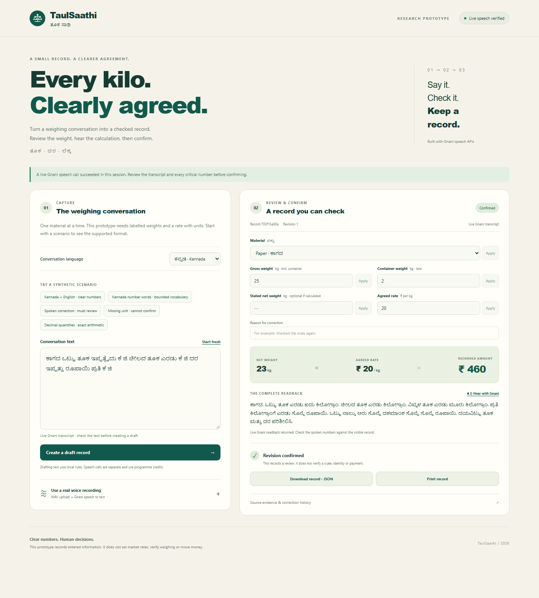

# TaulSaathi

### Fifteen or fifty? Check the number before keeping the receipt.

A correct multiplication can still use the wrong weight or rate. **TaulSaathi** is a small Kannada + English prototype for scrap-weighing conversations: speech becomes a draft, uncertain numbers stay visible, and a correction requires a new review.

**Actual Gnani Prisma STT → checked fields → Timbre readback → revision-bound confirmation → JSON export.**

[Watch the 60-second demo](media/TaulSaathi-demo.mp4) · [Run locally](#run-in-one-command) · [Inspect the evidence](#what-was-actually-tested) · [Read the research](docs/RESEARCH.md)

[](media/TaulSaathi-demo.mp4)

## The small task

For a fictional paper transaction, the app transcribed generated Kannada speech through the **actual Prisma API**:

> Gross 25 kg. Container 2 kg. Agreed rate ₹20 per kg.

The unchanged response produced **23 kg × ₹20/kg = ₹460.00**. The app requested a real 13.6-second Timbre readback, then confirmed and exported that exact revision. [Raw response](validation/live-ui-clear-transcription.json), [provenance-bearing receipt](validation/live-ui-confirmed-receipt.json), [returned audio](validation/live-ui-readback.wav).

The demo separately shows a **typed synthetic** fifteen-versus-fifty correction. The app holds the conflict, records an explicit correction and transcript review, and invalidates confirmation when the rate changes again. Generated speech and typed examples are labelled in the video. There are no customer testimonials or field-study claims.

## Run in one command

Python **3.10+**; no pip or npm packages required for the app.

```bash
python app.py
```

Open **http://127.0.0.1:8765**. Windows users can double-click `START.cmd`.

The first visit opens a labelled synthetic Kannada draft without making a paid speech request. Check **23 kg / ₹460**, try the conflicting-rate scenario, or apply a correction to a confirmed record. Download confirmed JSON before stopping the server: records live only in session memory.

### Use your own Gnani key

On Windows, `SETUP-LIVE.cmd` prompts for a masked key and keeps it only in the server process environment. It does not save the key to a file. Stop any previous server first.

On other systems, set `GNANI_API_KEY` securely in your shell environment, then run `python app.py`. Keep keys out of source, screenshots and commits. Live buttons are explicit and may consume provider credits; sample drafts do not.

Upload an uncompressed WAV of at most 30 seconds, choose Kannada, and click **Transcribe with Gnani**. Review the returned text, create a draft, resolve issues, and request the spoken readback. The live source label requires the unchanged response and a server-issued transcript token; edited text becomes typed input.

[Gnani STT documentation](https://docs.gnani.ai/api/STT/speech-to-text) · [TTS documentation](https://docs.gnani.ai/api/TTS/tts-inference)

## What the prototype checks

- One material, explicit kilograms, gross/tare or net weight, and an agreed INR-per-kg rate.
- Conflicting values, missing units, unsupported words and correction cues remain visible.
- Decimal arithmetic calculates the amount; the language model does not do the multiplication.
- Corrections create a new revision and invalidate the old confirmation.
- Confirmation and exports bind to the reviewed fields; source phrases and history remain inspectable.
- API keys stay server-side. Speech requests have bounds, sanitized errors and no automatic inference retries.

Supported materials: paper, plastic, iron, cardboard, aluminium and copper. The parser supports selected Kannada aliases, Kannada/Arabic digits, a bounded number-word vocabulary and observed split `ಕೆ ಜಿ` units. Missing container weight is never silently treated as zero.

## What was actually tested

| Evidence | Result | What it establishes |
|---|---|---|
| Offline software suite | 110 tests passed | Parser/state guards, mocked API contracts and local HTTP workflows |
| Authored text regressions | 50 cases passed | Expected records and blocked problem cases; not ASR accuracy |
| Actual browser speech flow | Generated Kannada audio → ₹460 record → real readback → confirmed JSON | Working Gnani integration for one fictional transaction |
| Four further generated development clips | Two decimal transcripts plus clean/noisy correction transcripts | Small development evidence, including parser failures and subsequent cached reanalysis |
| Browser and agent walkthroughs | Desktop/mobile workflow and revision checks exercised | Agent testing; not buyer/seller feedback |

The decimal examples informed the parser repair. The simulated noise is seeded white noise. These are **development cases, not held-out tests, natural human speech or real telephony**. Raw results and failure history are preserved in [validation/](validation/). [Exact claim limits](validation/LIVE-RESULTS.md), [software verification](docs/VERIFICATION.md), [demo provenance](docs/DEMO-NOTES.md).

```bash
python -m unittest discover -s tests -v
python evaluation/evaluate.py
python evaluation/evaluate.py --fixtures evaluation/adversarial-fixtures.json
```

Those commands run offline. `evaluation/run_live.py` is separate, opt-in and can consume credits; read [the protocol](evaluation/README.md) before using it.

## Limits that matter

This is a loopback-only research prototype with a bounded grammar, not unrestricted conversational accounting. Human-speaker Kannada accuracy, native-listener comprehension, spontaneous code mixing, real phone audio and target-user adoption are still unverified. It does not weigh anything, set fair prices, authenticate people, verify payment, calculate tax or move money. A hash records a field snapshot; it is not proof of identity or legal admissibility.

Review can override parser warnings, so a human can still confirm a mistaken value. Read the full transcript and check the physical scale and agreed rate. Do not treat a valid subtotal as proof that the input was correct.

## Help improve the real problem

Useful feedback is specific: an ambiguous number form, a synthetic failing transcript, an unclear readback, or a concrete weighing workflow this misses. Please use fictional transaction data. Obtain separate permission before sharing anyone's voice. [User-research task kit](docs/USER-FEEDBACK-KIT.md).

## Built with AI assistance

Codex assisted with idea research, architecture, implementation, tests, documentation, browser walkthroughs and the demo. Evidence is labelled by source: actual provider responses, generated audio, typed examples and automated checks. This repository does not claim a human user study, unique invention, guaranteed safety or a competition win.

Built for the Great Indian AI Internship Challenge using Gnani APIs. This is an independent participant project; no endorsement by Gnani or a public authority is implied. Prior art and research are linked in [the decision report](docs/RESEARCH.md). No license grant is included yet; ask the maintainer before reusing the code beyond applicable platform terms.
